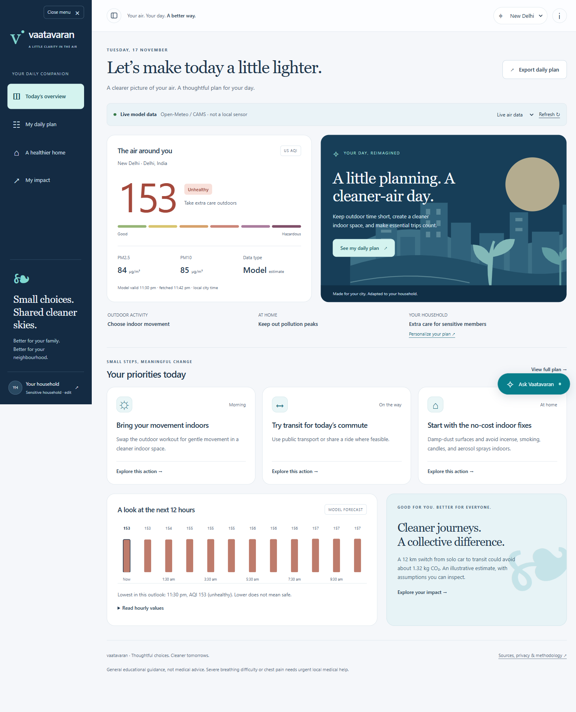

# Vaatavaran

**A little clarity in the air.** An explainable, context-aware Urban Air Quality Assistant for families and communities navigating winter smog.

Challenge 06 · Urban Air Quality Assistant · [Public repository](https://github.com/immortalfoodie/Vaatavaran)



## Run in under a minute

Requires **Node.js 22.9+** (Node 24 recommended) and Git. No dependency installation, framework build, database, or account is needed.

```sh
git clone https://github.com/immortalfoodie/Vaatavaran.git
cd Vaatavaran
npm start
```

Open **http://localhost:3000** (defaults to **Mumbai**, with 10 preset Indian cities plus worldwide **Search Any City** via Open-Meteo Geocoding).

- With `GOOGLE_AIR_QUALITY_API_KEY` set in `.env`, the app uses **Google Air Quality API (500 m sensor-fused grid)** converted to US EPA AQI (cached 10 min), paired with a separate Open-Meteo / CAMS 12-hour outlook.
- With `WAQI_API_TOKEN` set (without Google Air), it supports nearby ground-station observations via WAQI.
- With no air-quality keys at all, it runs live on **Open-Meteo / Copernicus CAMS** (with 24-hour trend and 12-hour outlook) or offline **Demo scenario** mode.

```sh
npm run dev      # restart the server when source files change
```

### Quality checks (contributors)

The app itself has **zero runtime dependencies**. Quality tooling is dev-only:

```sh
npm install          # ESLint, Prettier and TypeScript (type checking only; no build step)
npm run verify       # lint + format + strict type check + 97 tests with coverage + size budget
```

| Script                  | What it enforces                                                                      |
| ----------------------- | ------------------------------------------------------------------------------------- |
| `npm run lint`          | ESLint recommended rules, complexity ≤ 14, max 4 params, JSDoc on exports, 0 warnings |
| `npm run format:check`  | Prettier formatting (100-column, LF line endings)                                     |
| `npm run typecheck`     | `tsc --checkJs` in **strict** mode against JSDoc types in `public/types.js`           |
| `npm run test:coverage` | `node:test` with coverage gates (≥ 90% lines/functions, ≥ 80% branches)               |

CI runs the same steps on Node 22 and 24 for every push and pull request.

## Chosen vertical and persona

**Urban Air Quality Assistant.** The primary persona is an urban Indian household balancing school, work, exercise, indoor air and a limited budget during winter smog. A secondary persona is a neighbour or community organizer sharing practical, low-emission habits.

The goal is to turn “AQI is high” into **what to change, why it matters, and what trade-offs remain**. The app ships 10 preset Indian cities (New Delhi, Mumbai, Bengaluru, Kolkata, Lucknow, Chennai, Hyderabad, Pune, Ahmedabad and Jaipur) plus worldwide city search, with city-local time throughout.

## What works

- **Today’s overview:** US AQI, categories, PM2.5/PM10 concentrations, source/time labels, an "Updated X minutes ago" freshness line and a 12-hour outlook with an accessible data table.
- **India NAQI beside US AQI:** an estimate on CPCB’s six-band National AQI (Good → Severe) from the current PM2.5/PM10 concentrations. It is labelled as an estimate (official CPCB values use 24-hour averages of up to eight pollutants) and hidden for station feeds, which report pollutant indices rather than concentrations.
- **Personalized daily plan:** movement, commute and home actions respond to household sensitivity, travel mode, total daily distance, purifier access, budget and preferred exercise time.
- **Explainable decisions:** every plan action includes its rationale and its practical exposure or emissions impact. A lower forecast value is never presented as automatically safe.
- **A healthier home:** practical source control, ventilation and filtration guidance, with no-cost options first when appropriate.
- **Impact calculator:** inspect the assumptions behind an illustrative car-to-transit carbon comparison. Estimates are never represented as measured savings or health improvements.
- **Contextual assistant:** optional real generative AI, with a clearly labeled deterministic local guide when disabled or unavailable. Emergency symptom patterns bypass AI.
- **Daily checklist:** browser-local progress; resets when household context changes. Plain-text household and community exports omit explicit health preferences.
- **Accessible interface:** semantic landmarks, native controls, keyboard navigation, visible focus, modal dialogs with Escape dismissal, status announcements, text labels in addition to color, reduced-motion support, responsive layouts, a light/dark theme that follows the operating system by default, with a header toggle (Auto → Light → Dark) that is remembered and applied before first paint, and skeleton placeholders (with `aria-busy`) instead of misleading "unavailable" text while data loads.

## Enable Gemini on the free tier

1. Create a key in [Google AI Studio](https://aistudio.google.com/api-keys). Use a project without paid billing if you only want free-tier access.
2. Copy `.env.example` to `.env` **only if you do not already have one**, then enter your key locally:

```dotenv
GEMINI_API_KEY=your-key-here
GEMINI_MODEL=gemini-3.5-flash-lite
```

3. Restart `npm start`, reload the page, open **Ask Vaatavaran**, and opt into **Use generative AI**.

The server calls Gemini’s `generateContent` API directly, without an SDK or paid fallback provider. The model is configurable. Google currently lists free-tier input/output for this model, subject to account access and quotas; check the [official pricing page](https://ai.google.dev/gemini-api/docs/pricing). The app cannot inspect or change your Google billing settings.

Your key stays on the server; `.env` is ignored by Git. Never paste keys into source files or the assistant. **Free-tier content may be used by Google to improve its products**, so the UI requires explicit opt-in and warns against entering personal details.

Gemini receives the selected city, question, normalized household preferences, server-verified air data and deterministic plan. Quota errors, blocked/truncated answers and provider outages return a labeled local-guide answer. No automatic retries burn through your quota. The rule-based plan remains independent because generated advice can be wrong.

**Without a key, the local guide works but is not generative AI.** Each question is independent. Emergency guidance runs on-device and on the server without waiting for either external provider.

## Approach and decision logic

```text
City + data mode → validated air data → deterministic recommendation engine
                                              ↑
                              household preferences
                                              ↓
                     daily plan + reasons + transparent impact
                                              ↓
                  optional AI explanation / labeled local guide
```

| Context                             | Decision                                           | Reason                                             |
| ----------------------------------- | -------------------------------------------------- | -------------------------------------------------- |
| US AQI 151+                         | Move strenuous activity indoors                    | Reduce polluted-air exposure for everyone          |
| US AQI 101+ and sensitive household | Apply stricter activity guidance                   | Sensitive groups warrant earlier precautions       |
| US AQI 201+                         | Postpone nonessential journeys                     | Avoid optimizing carbon at the expense of exposure |
| Low budget, no purifier             | Prioritize source control and damp dusting         | Useful actions without assuming purchasing power   |
| Purifier available                  | Use a correctly sized particle cleaner as directed | Adapt to equipment already owned                   |
| Missing live data                   | Show unavailable and local-monitoring guidance     | Unknown air is not clean air                       |
| AI unavailable / no consent         | Clearly labeled local guide                        | Preserve utility without pretending AI succeeded   |

Categories use **US AQI**: 0–50, 51–100, 101–150, 151–200, 201–300, 301–500. They are **not India’s National AQI categories**. WAQI pollutant fields are individual AQI subindices, not mass concentrations: station mode displays these separately labeled US AQI values, with “Not reported” for missing values. Model mode displays the supplied hourly PM concentrations in µg/m³; its particulate AQI uses 24-hour averages.

## Assumptions and honest limitations

1. Demo readings are fictional fixed scenarios, not observations. Their hourly timestamps are relative to the current hour for demonstration.
2. Station mode shows one nearby station, its reporting time, distance from the selected city centre, and agency attribution. It rejects readings older than three hours or stations farther than 75 km; it does not claim a city-wide average. Station numeric data is not cached, archived or exported. Regional forecast mode uses the approximately 45 km CAMS global model, caches responses for 10 minutes and shows a 12-hour outlook. Sources, stations and averaging periods can disagree; model forecasts are never spliced onto station readings. Recheck local authorities before consequential decisions.
3. Household “sensitivity” is a user-selected precaution, not a diagnosis. The app does not infer conditions, recommend medication, or measure indoor air.
4. The carbon scenario assumes **0.17 kg CO₂/km for solo car** and **0.06 kg CO₂/passenger-km for transit**. These are explicit illustrative constants, not locally validated emission factors. Distance is total daily travel, not one-way distance. Actual occupancy, power source, traffic and vehicles change results.
5. Lower emissions and lower personal exposure are different objectives. A transit switch is not always feasible or cleaner for the passenger. Severe air-quality guidance takes priority.
6. The household plan may reveal preferences indirectly through adapted actions even though exports exclude explicit sensitivity fields. Review an export before sharing it.
7. The MVP has 10 preset cities plus search (demo scenarios exist only for presets), English content, no user accounts and no long-term history. It does not send notifications or invent community activity. Each assistant question is independent and uses the current household context.
8. This is educational support, not emergency or clinical care. Severe breathing difficulty or chest pain requires urgent local medical help.

## Architecture

Zero runtime dependencies; a small Node HTTP server and native browser modules keep the code auditable and the repository tiny.

```text
public/index.html        Semantic dashboard, views, settings and chat dialogs
public/style.css         Responsive visual system (with reduced-motion support)
public/app.js            Controller: wires state, routing, air loading and UI events
public/state.js          Validated app state restored from / persisted to localStorage
public/api.js            Browser API client (deadlines, server error messages)
public/chat.js           Assistant dialog: emergency bypass, AI/local answers, fallbacks
public/city-search.js    Worldwide city search and multi-city comparison
public/views.js          Stateless dashboard card and panel renderers
public/charts.js         CSP-safe SVG dot-matrix, heatmap and CO₂ chart renderers
public/storage.js        localStorage helpers and privacy-safe plan export
public/dom.js            `$` / `el` helpers (textContent only, never innerHTML)
public/engine.js         Shared pure AQI, planning, readiness, impact and local-guide logic
public/aqi-scales.js     US EPA and India CPCB NAQI breakpoints and sub-index interpolation
public/format.js         Locale-aware clock times and "4 minutes ago" relative ages
public/theme.js          Auto / Light / Dark theme toggle (CSS tokens use light-dark())
public/theme-boot.js     Applies a saved theme before first paint (CSP-safe, no inline script)
public/time.js           Shared time-unit constants (browser + server)
public/types.js          JSDoc type definitions (type checking only; never served)
server.mjs               HTTP server & Vercel handler: routing, security headers, handlers
lib/request.mjs          Body limits, custom-city validation, client IP resolution
lib/rate-limit.mjs       Bounded per-client fixed-window limiter (API + AI sub-limit)
lib/http.mjs             Upstream fetch with deadline + TTL cache with in-flight sharing
lib/air-quality.mjs      Source selection, Open-Meteo/CAMS parsing, 24h delta, geocoding
lib/google-air.mjs       Google Air Quality API (500 m) client and US EPA AQI conversion
lib/station-air.mjs      WAQI ground-station parser and provenance checks
lib/assistant.mjs        Server-only Gemini adapter and grounding instructions
test/*.test.mjs          Unit, API, security, privacy and provider tests (node:test)
vercel.json              Vercel security headers (mirrors server.mjs)
eslint.config.js         Lint rules and maintainability budgets
jsconfig.json            Strict JSDoc type checking configuration
scripts/check-size.mjs   Source budget check (<10 MB)
.github/workflows/ci.yml Lint, format, type check, coverage and size on Node 22 and 24
```

## Security and privacy

- Serve only explicitly allowlisted public files; `.env`, Git metadata and server source cannot be downloaded.
- Strict same-origin CSP, no third-party scripts/fonts, no `innerHTML` for user/provider content, framing disabled, MIME sniffing disabled.
- JSON request limit of 8 KiB, question limit of 1,000 characters, supported-city allowlist and normalized household values.
- Fixed upstream URLs prevent caller-selected proxy destinations. Network deadlines, in-flight coalescing and per-city caching bound work.
- In-memory per-IP limits: 60 API requests/minute, with at most 8 AI requests/minute; the client table is bounded. `X-Forwarded-For` is trusted only on Vercel or when `TRUST_PROXY=1` is set explicitly.
- Server API keys are sent to Google in request headers, never in URLs, so they cannot leak into proxy or access logs.
- Same-origin checks for chat POSTs; no permissive CORS. Gemini requires explicit per-page user opt-in; free-tier provider data-use terms are explained in the UI.
- No analytics, tracking cookies, database, question logging or client-visible secrets. Preferences and completion are stored only in localStorage; chat stays in memory. **Reset saved data** clears these local settings and the current chat.

For Internet hosting, run behind HTTPS, set `HOST=0.0.0.0` and `APP_ORIGIN=https://your-host.example`, and configure the platform’s `PORT`. Before exposing a shared API key publicly, add authentication and persistent/distributed abuse limits to protect the free quota. Keep paid billing disabled for a free-only deployment. In-memory rate limits reset on process restart and may group visitors behind a reverse proxy. Provider retention/processing policies still apply to submitted data.

## Validation

`npm run verify` runs 97 deterministic tests without external network or paid AI calls, and fails if coverage drops below the configured thresholds. Tests use real ephemeral localhost HTTP servers and mock only external providers. Coverage includes all AQI boundaries, invalid values, sensitive households, activity readiness, severe-smog travel, budget-aware indoor advice, carbon arithmetic, 24h deltas, geocoding, Google Air Quality 500m parsing/caching, stale data, caching, origin checks, malformed/oversized requests, secret-file denial, consent, trusted context, emergency handling, provider fallbacks, rate-limit windows, request-body limits, custom-coordinate bounds, export privacy, API keys kept out of URLs, India NAQI bands (including CPCB’s published interpolation examples), relative-time formatting, theme toggle and theme-token consistency, and a check that every browser module is allowlisted by the server.

Browser QA covers desktop (1440 px), mobile (390 px), settings updates, persisted checklist state, city switching, assistant responses, literal rendering of HTML-like input, export downloads, impact calculations, simulated live outage and keyboard dialog dismissal. See [validation notes](docs/VALIDATION.md) for final results and limitations.

## Evaluation guide

Try this two-minute walkthrough:

1. The app opens on Mumbai. Select **New Delhi** and inspect the live reading, then switch to Explore demo: identify the **demo label**, very-unhealthy category and three actionable priorities.
2. Open household settings; select work-from-home, a purifier and a no-cost budget. Watch the recommendations change and inspect **Why this fits your day**.
3. Switch to Chennai to see a good-air scenario; switch back to Delhi and notice the conservative activity advice.
4. Ask “Can my child play outside?” and “Should I open the windows?” Check that the response source is labeled.
5. Explore **My impact**, change distance, and inspect the assumptions rather than a false precision claim.
6. Select **Live air data**, inspect source/time labels, and export a checklist.
7. Configure your API key locally and opt in to demonstrate actual generative explanations.

## Sources and attribution

- Air-quality data: [Open-Meteo Air Quality API](https://open-meteo.com/en/docs/air-quality-api), using [Copernicus Atmosphere Monitoring Service (CAMS)](https://atmosphere.copernicus.eu/). Follow their attribution and licensing terms for deployment; the public endpoint’s free-use terms may not fit commercial traffic.
- AQI categories: [AirNow AQI Basics](https://www.airnow.gov/aqi/aqi-basics/).
- India National AQI bands: CPCB National Air Quality Index (2014), summarised by [IES Arthapedia](https://ies.gov.in/arthapedia/concept/national-air-quality-index). The open-ended Severe bands use the 380 µg/m³ (PM2.5) and 510 µg/m³ (PM10) upper bounds from CPCB’s AQI calculator so they can be interpolated; values are capped at 500.
- Particle filtration and source control: [US EPA Indoor Air Filtration](https://www.epa.gov/wildfires/indoor-air-filtration) and [AirNow Be Smoke Ready](https://www.airnow.gov/wildfires/be-smoke-ready/). Particle-reduction guidance does not address every urban gas pollutant.
- AI integration: [Gemini generateContent API](https://ai.google.dev/api/generate-content), [model availability](https://ai.google.dev/gemini-api/docs/models), and [free-tier pricing and data use](https://ai.google.dev/gemini-api/docs/pricing).

## Submission rules

- Public repository: **https://github.com/immortalfoodie/Vaatavaran**.
- Use only the **main** branch; no feature branches are required.
- Source is well below **10 MB**; generated QA screenshots and dependencies are ignored. `npm run verify` enforces the source budget. Git history is checked separately before delivery.
- No competition submission attempt is made by this application or its tests. Submit the repository link through the competition portal yourself, within the maximum three attempts.

MIT licensed. Original vector illustration and interface; no downloaded image assets.

### Station data

The optional [WAQI API](https://aqicn.org/api/) requires a server-side token. Display attribution to WAQI and the originating monitoring agencies is retained beside the reading. Data is provisional. Follow the provider's use terms, including restrictions on redistribution, archival, commercial use and requirements for public organizational deployment; a free token is not an unrestricted data licence. The application does not store station readings or include their numeric values in plan exports.
